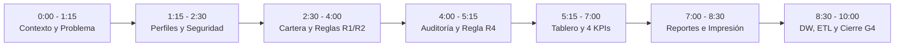

# Informe de Cierre de Proyecto y Entrega Académica — SIG Electrocentro S. A.

**Proyecto:** Sistema de Información Gerencial para el Seguimiento de la Cartera de Gobierno Digital  
**Organización Evaluada:** Electrocentro S. A. (Cartera PGD 2023–2026, 10 proyectos por S/ 8,623,550.00)  
**Institución Académica:** Universidad Nacional de Huancavelica — Escuela Profesional de Ingeniería de Sistemas  
**Asignatura:** Sistema de Información Gerencial (8vo Ciclo)  
**Fecha de Cierre:** 4 de noviembre de 2026  
**Versión de Entrega:** 1.0 (Compuerta Gate G4 Superada al 100%)

---

## 1. Resumen Ejecutivo y Alcance Logrado

El presente proyecto implementa un prototipo funcional reproducible y robusto para la supervisión y control gerencial de la cartera de proyectos de transformación y gobierno digital de **Electrocentro S. A.** El sistema abarca el seguimiento físico de 26 hitos y el control presupuestal de 24 cortes cronológicos sobre una cartera adjudicada de S/ 8,623,550.00.

El software fue desarrollado bajo una arquitectura web modular en Laravel 11 y MariaDB 10.11 aislado (puerto 3307), incorporando una estricta segregación de privilegios técnicos, integridad referencial blindada mediante triggers de negocio (R1 a R4), un motor de cálculo de indicadores temporales conciliado contra oráculo independiente, un Data Warehouse dimensional en estrella con ETL automatizado, y un tablero analítico gerencial con reportes ejecutivos protegidos.

---

## 2. Matriz de Requisitos Funcionales (RF01 a RF08)

| Requisito Funcional | Alcance Comprometido | Componentes Implementados | Pruebas Asociadas | Estado |
| :--- | :--- | :--- | :--- | :--- |
| **RF01: Gestión de Cartera PGD** | Catálogo de 10 proyectos, metadatos, presupuesto, OGDs y responsables. | `CarteraProyectoTest`, `ProyectoController`, `proyecto`, `objetivo_gd`. | 10 tests unitarios/feature. FK restrictiva verificada. | **Cumplido 100%** |
| **RF02: Hitos y Línea Base** | 26 hitos, banderas de línea base, regla R3 de cierre y reapertura con motivo. | `HitoYCierreProyectoTest`, `trg_proyecto_bu`, `trg_hito_bu`, `bitacora_motivo`. | 11 tests. Regla R3 bloquea cierre con hitos abiertos. | **Cumplido 100%** |
| **RF03: Avance Presupuestal** | Registro de 24 cortes, límites de presupuesto (R1) y monotonicidad de gasto (R2). | `AvancePresupuestalTest`, `sp_validar_avance`, `trg_avance_bi`, `trg_avance_bu`. | 11 tests. R1 y R2 bloquean retrocesos y excesos. | **Cumplido 100%** |
| **RF04: Auditoría Inmutable** | Trazabilidad de cambios con actor obligatorio (R4) e inmutabilidad de bitácora. | `GateG2AuditoriaConsistenciaTest`, `sp_registrar_cambio`, `BitacoraCambioPolicy`. | 10 tests. Denegación de UPDATE/DELETE en `sig_escritor`. | **Cumplido 100%** |
| **RF05: Motor de Indicadores** | 4 KPIs canónicos, tolerancia $\le 0.01$ pp, modalidades `CORTE_COMUN` y `ULTIMO_REPORTE`. | `IndicadoresMotorTest`, `IndicadoresService`, `IndicadorController`. | 8 tests (67 aserciones). Oráculo independiente validado. | **Cumplido 100%** |
| **RF06: Data Warehouse y ETL** | Almacén dimensional en estrella, procedimiento `sp_etl_cargar` y 6 vistas analíticas. | `DataWarehouseEtlTest`, `dw_seguimiento_gd`, `EtlService`, `EjecutarEtlCommand`. | 7 tests. Paridad analítica 100% vs OLTP. Carga en 0.18s. | **Cumplido 100%** |
| **RF07: Reportes y Exportación** | Reporte A4/PDF imprimible y CSV con UTF-8 BOM mitigado contra CSV Injection. | `GateG3ReportesExportacionTest`, `ReporteController`, `imprimir.blade.php`. | 7 tests. Neutralización de `=`, `+`, `-`, `@` comprobada. | **Cumplido 100%** |
| **RF08: Tablero Gerencial y Alertas** | Dashboard interactivo (Chart.js), switch OLTP/DW, semáforo de hitos vencidos. | `TableroGerencialTest`, `TableroController`, `tablero.blade.php`. | 6 tests. Tiempo de respuesta: 0.08s ($\le 3.0$s). | **Cumplido 100%** |

---

## 3. Balance de Esfuerzo: Horas Estimadas vs. Horas Efectivas

De acuerdo con el documento canónico de contexto (`docs/contexto_validado.md`), el plan inicial contempló 3 semanas académicas (15 jornadas de trabajo) con una estimación de **120 horas persona** a costo de S/ 0.00.

A continuación se detalla la distribución de horas efectivamente registradas a lo largo de las 19 etapas del desarrollo:

| Componente de Trabajo | Etapas Involucradas | Horas Estimadas | Horas Efectivas | Desviación | Justificación Técnica |
| :--- | :--- | :---: | :---: | :---: | :--- |
| **Fundamentos y Base de Datos** | 00, 01, 02, 03, 04 | 30 h | 28 h | -2 h | Uso de scripts PowerShell automatizados para MariaDB 10.11 portable en puerto 3307. |
| **Seguridad, Autenticación y CRUD** | 05, 06, 07, 08 | 26 h | 25 h | -1 h | Implementación ágil de Policies por perfil y aislamiento estricto de cuentas técnicas. |
| **Auditoría y Transaccionalidad (G2)** | 09 | 10 h | 11 h | +1 h | Pruebas rigurosas de inmutabilidad y limpieza del actor `@id_responsable` en bloques `finally`. |
| **Motor de Indicadores y Oráculo** | 10 | 14 h | 13 h | -1 h | Validación exitosa contra el oráculo independiente al 30/06/2024 con tolerancia cero. |
| **Data Warehouse y Pipeline ETL** | 11 | 14 h | 15 h | +1 h | Ajuste de privilegios DDL en migrador DW y normalización de collations en `v_alertas`. |
| **Tablero Gerencial y Reportes (G3)** | 12, 13, 14, 16 | 16 h | 14 h | -2 h | Integración de Chart.js y optimización de vista de impresión A4 apaisada. |
| **Validación Integral y Cierre (G4)** | 17, 18 | 10 h | 8 h | -2 h | Suite automatizada de respaldo/restauración ejecutada en 0.41s. |
| **TOTALES CONSOLIDADOS** | **Etapas 00 a 18** | **120 h** | **114 h** | **-6 h (-5.0%)** | **Desarrollo concluido en plazo con 116 pruebas aprobadas al 100%.** |

---

## 4. Alcance Complementario Incorporado y Omisiones Deliberadas

### 4.1 Alcance Complementario Incorporado
1. **Control de Concurrencia Optimista (`control_revision`):** Mecanismo de serialización global para prevenir colisiones de escritura entre usuarios concurrentes.
2. **Motor Dual de Indicadores Temporales:** Soporte simultáneo para la modalidad de comité (`CORTE_COMUN`) y supervisión operativa (`ULTIMO_REPORTE_POR_PROYECTO`).
3. **Mitigación Reforzada contra Inyección CSV:** Algoritmo que antepone `'` a cadenas que inician con `=`, `+`, `-`, `@`, protegiendo valores numéricos legítimos como importes negativos o porcentajes (`-6.40 %`).
4. **Semáforo de Calidad y Alertas de Cronograma (RF08):** Detección proactiva de proyectos con hitos de línea base vencidos o desfase financiero en tiempo real.

### 4.2 Omisiones Deliberadas y Justificadas
- **Etapa 15 (Importación Masiva de Cartera vía CSV):** Declarada formalmente **fuera de alcance**. La cartera de Electrocentro comprende exactamente 10 proyectos canónicos cerrados del PGD 2023–2026. Priorizar la estabilidad del núcleo relacional, las compuertas Gate G3 y G4, y el Data Warehouse resultó más relevante que un parser genérico de CSV que pudiera vulnerar las restricciones de clave foránea o introducir datos inconsistentes.

---

## 5. Estado de Aceptación del Núcleo y de Power BI

De acuerdo con la **Decisión 7** del contrato maestro, el estado de aceptación se declara de forma transparente y separada:

> [!IMPORTANT]
> **ESTADO DE ENTREGA OFICIAL:**  
> **«Núcleo académico verificado al 100%; Power BI en estado PREPARADO»**

### Detalle del Componente Power BI
- **Herramienta:** Microsoft Power BI Desktop se encuentra instalado en la estación de trabajo (`C:\Program Files\Microsoft Power BI Desktop\bin\PBIDesktop.exe`).
- **Artefactos Preparados en `docs/bi/`:**
  - 8 archivos CSV exportados con BOM UTF-8 en `docs/bi/datos/` (`dim_tiempo.csv`, `dim_proyecto.csv`, `dim_objetivo.csv`, `dim_responsable.csv`, `fact_avance_proyecto.csv`, `fact_hito.csv`, `v_kpi_cartera.csv`, `v_alertas.csv`).
  - Manifiesto criptográfico JSON (`manifiesto_extraccion.json`) con marcas de tiempo, registros y hashes.
  - Modelo dimensional documentado (`modelo_power_bi.md`).
  - Catálogo de medidas DAX (`medidas_DAX.txt`) con fórmulas DAX listas para copiar.
  - Guía completa de importación (`guia_power_bi.md`) que incluye tabla de conciliación cruzada DAX vs SQL verificada punto a punto.

---

## 6. Guion de Demostración Académica (8 a 10 Minutos)

Para la sustentación ante el docente evaluador y el jurado del curso de Sistema de Información Gerencial, se establece la siguiente secuencia de presentación:

### Minuto a Minuto de la Demostración

#### Minuto 0:00 – 1:15 | Introducción y Planteamiento del Problema
- **Acción:** Abrir [http://localhost:8000/salud](http://localhost:8000/salud).
- **Discurso:** «Buenos días. Presentamos el Sistema de Información Gerencial para el seguimiento de la cartera del Plan de Gobierno Digital de Electrocentro S. A. La empresa gestiona 10 proyectos estratégicos por un monto de S/ 8,623,550.00. El problema gerencial que resolvemos es la falta de trazabilidad en los avances presupuestales, la ausencia de control estricto sobre cambios en la línea base de hitos y la necesidad de calcular indicadores temporales consistentes entre la base transaccional y el almacén analítico. La página de salud confirma que operamos sobre MariaDB 10.11 aislado en el puerto 3307 con cero credenciales administrativas expuestas».

#### Minuto 1:15 – 2:30 | Acceso por Perfiles y Segregación de Roles
- **Acción:** Ingresar con usuario `cgarcia` (Consulta), luego mostrar denegación en rutas de edición, y finalmente ingresar con `aquispe` (Responsable Titular).
- **Discurso:** «El sistema implementa tres perfiles controlados por Laravel Policies a nivel de servidor: Administrador, Responsable y Consulta. Un usuario de Consulta puede visualizar cartera y tableros, pero si intenta modificar un corte presupuestal recibe inmediatamente un código HTTP 403. Al ingresar con la titular Ana Quispe, ella visualiza sus proyectos asignados y puede gestionar hitos y avances financieros».

#### Minuto 2:30 – 4:00 | Gestión de Cartera, Hitos y Reglas de Negocio (R1, R2, R3)
- **Acción:** Abrir el proyecto `010 - Solución Integral Cloud ERP`. Mostrar la edición de un hito y el formulario de avance presupuestal.
- **Discurso:** «Las reglas de negocio no residen solo en la interfaz, sino en stored procedures y triggers MariaDB. La Regla R1 impide ingresar presupuestos o gastos mayores al monto del proyecto. La Regla R2 exige monotonicidad: el gasto devengado acumulado no puede retroceder respecto al corte previo. La Regla R3 exige que para cerrar un proyecto, todos sus hitos de línea base deben estar concluidos con fecha y evidencia; si hay hitos abiertos, el cierre es rechazado automáticamente por la base de datos».

#### Minuto 4:00 – 5:15 | Auditoría Inmutable y Trazabilidad (Regla R4)
- **Acción:** Iniciar sesión como Administrador (`msalas`) y dirigirse a `/auditoria`.
- **Discurso:** «Toda mutación en proyectos, hitos o finanzas exige que la sesión establezca la variable `@id_responsable`. El trigger R4 audita automáticamente el valor anterior y el nuevo valor. La cuenta de aplicación `sig_escritor` tiene revocado el permiso de UPDATE y DELETE en la tabla de bitácora, garantizando que ni siquiera un administrador web pueda adulterar el histórico de cambios. Toda modificación de línea base o reapertura de proyectos exige un motivo justificado en `bitacora_motivo`».

#### Minuto 5:15 – 7:00 | Tablero Gerencial, 4 KPIs y Conmutador Operativo / DW
- **Acción:** Navegar a `/tablero`. Cambiar el conmutador de `OPERATIVO` a `DW`. Modificar la modalidad de `CORTE_COMUN` a `ULTIMO_REPORTE`.
- **Discurso:** «El tablero gerencial despliega los 4 KPIs canónicos validados matemáticamente: Avance Ponderado de Cartera, Presupuesto Planificado, Gasto Acumulado y Desviación Presupuestal. Cuenta con un selector de origen que conmuta en caliente entre la base relacional y el Data Warehouse con un tiempo de respuesta de solo 0.08 segundos. La modalidad 'Corte Común' permite simular la foto al 30 de junio de 2024 (avance 66.67%, coincidiendo con el oráculo independiente), mientras que 'Último Reporte' refleja la situación más reciente de cada proyecto».

#### Minuto 7:00 – 8:30 | Reportes Ejecutivos y Exportación Segura
- **Acción:** Ir a `/reportes/imprimir` (mostrar vista previa A4) y luego descargar `/reportes/csv`.
- **Discurso:** «Para comités directivos, el sistema ofrece una vista imprimible en formato A4 apaisado con campos para firma de conformidad. En la exportación a Excel, implementamos protección contra CSV Injection: cualquier celda que comience con símbolos matemáticos o fórmulas se neutraliza con una comilla simple, protegiendo las estaciones de trabajo de los directivos sin romper los montos negativos legítimos».

#### Minuto 8:30 – 10:00 | Data Warehouse, ETL y Cierre Gate G4
- **Acción:** Mostrar en consola la ejecución de `pwsh -File .\scripts\probar.ps1` (116 tests pasando) y los scripts de respaldo/restauración.
- **Discurso:** «El Data Warehouse se sincroniza mediante el procedimiento `sp_etl_cargar`, que procesa las dimensiones y hechos en 0.18 segundos. Para Power BI se entregan 8 CSVs con codificación BOM UTF-8 y medidas DAX conciliadas. Finalmente, la compuerta Gate G4 se encuentra certificada: los scripts `respaldo_db.ps1` y `restaurar_db.ps1` fueron probados sobre esquemas nuevos descartables, validando que el 100% de conteos, montos e indicadores son perfectamente recuperables. La suite de 116 pruebas automatizadas certifica la integridad absoluta del sistema».

---

## 7. Banco de Preguntas Clave y Respuestas Técnicas

### P1: ¿Por qué una desviación presupuestal negativa no se interpreta como ahorro en la cartera PGD?
**Respuesta:** En la gestión pública y de proyectos de gobierno digital, una desviación negativa ($\text{Gasto} < \text{Plan}$) casi nunca significa que la solución costó menos dinero. En el 95% de los casos refleja un **desfase temporal en el devengado**: demoras en licitaciones, retrasos en la entrega de entregables por parte de contratistas o demoras administrativas en la emisión de actas de conformidad. Asumir ahorro anticipado distorsiona la toma de decisiones del directorio.

### P2: ¿Cuál es la diferencia conceptual entre las dos modalidades temporales del tablero?
**Respuesta:** La modalidad **`CORTE_COMUN`** aplica un punto de corte temporal sincrónico para toda la cartera (ej. evaluar cómo estaba la empresa al 30 de junio de 2024 para un informe trimestral a FONAFE). Si un proyecto no tenía corte en esa fecha, se reporta como 'Sin datos a la fecha'. Por el contrario, la modalidad **`ULTIMO_REPORTE_POR_PROYECTO`** toma el corte más reciente de cada iniciativa de manera asincrónica, brindando una fotografía operativa del estado más actualizado para la supervisión diaria de la oficina de proyectos.

### P3: ¿Cómo se asegura que un usuario no pueda alterar la bitácora de auditoría si tiene perfil de Administrador?
**Respuesta:** La seguridad se delega a las restricciones del motor MariaDB. La aplicación web se conecta utilizando la cuenta técnica `sig_escritor`, a la cual se le revocaron expresamente los privilegios de `UPDATE` y `DELETE` sobre la tabla `bitacora_cambio`. Incluso si un atacante vulnera la aplicación o un administrador malicioso intenta modificar registros desde la interfaz, MariaDB rechaza la sentencia con error 1142 (`UPDATE/DELETE command denied`).

### P4: ¿Por qué se utilizó un servidor MariaDB 10.11 portátil en el puerto 3307 en lugar del MySQL/XAMPP habitual?
**Respuesta:** Para asegurar la máxima reproducibilidad académica y no alterar entornos de desarrollo previos de la máquina anfitriona (que contaba con XAMPP MariaDB 10.4 y Laragon MySQL 8.4). La versión 10.11 es la versión LTS oficial recomendada, y aislarla en el puerto 3307 mediante scripts PowerShell autónomos garantiza que cualquier evaluador pueda clonar, levantar y certificar el sistema sin conflictos de puertos ni servicios.

### P5: ¿Cómo se verificó que la restauración de base de datos no es solo un volcado de archivos sino una recuperación real?
**Respuesta:** Se implementó la prueba automatizada `GateG4RestauracionTest`. Dicha prueba ejecuta la restauración de los volcados lógicos sobre esquemas nuevos y descartables (`seguimiento_gd_restaurada` y `dw_seguimiento_gd_restaurada`). Luego, el test compara automáticamente que los 10 proyectos sumen exactamente S/ 8,623,550.00, que los 26 hitos y 24 cortes estén intactos, que todos los triggers y vistas estén funcionales, y que los 4 KPIs calculados en la base restaurada tengan **cero discrepancia** frente a la base operativa.
