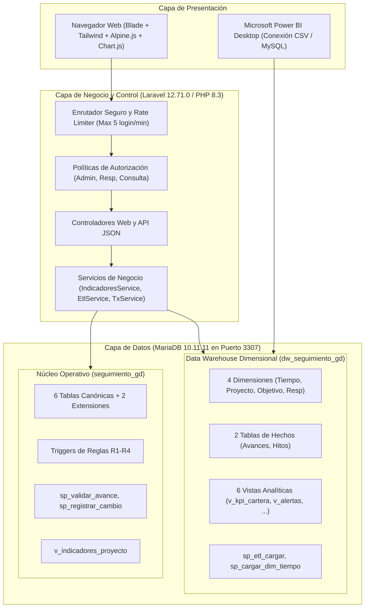
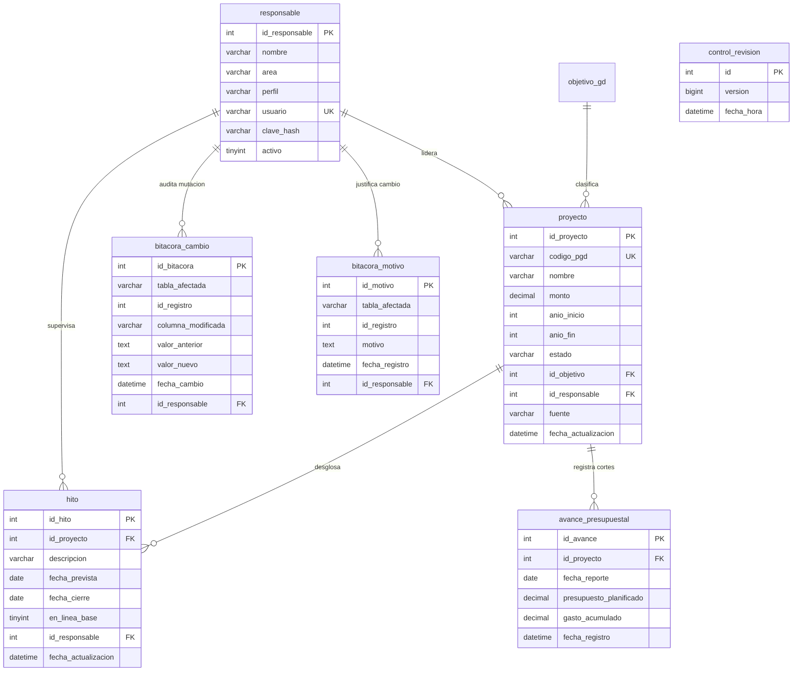
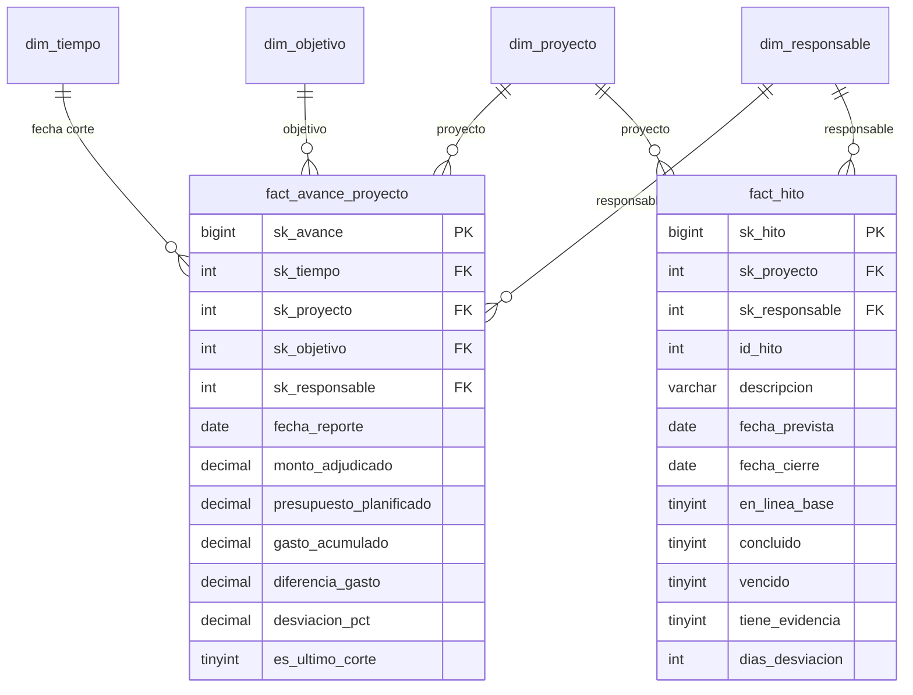

# Manual Técnico de Arquitectura e Implementación — SIG Electrocentro S. A.

**Sistema de Información Gerencial para el Seguimiento de la Cartera de Gobierno Digital**  
**Organización:** Electrocentro S. A. (Cartera PGD 2023–2026, 10 proyectos por S/ 8,623,550.00)  
**Fecha:** 4 de noviembre de 2026  
**Versión:** 1.0 (Entrega Técnica Canónica - Gate G4)

---

## 1. Visión General de la Arquitectura

El **SIG Electrocentro** está diseñado bajo un patrón arquitectónico desacoplado en capas, integrando un núcleo transaccional relacional (OLTP) de alta integridad con un Data Warehouse dimensional (OLAP) para análisis gerencial y explotación de Business Intelligence.

---

## 2. Esquema Relacional Operativo (`seguimiento_gd`)

El modelo operativo preserva la estructura canónica del informe de dominio original, separando con rigor las seis tablas operativas originales de las dos extensiones técnicas de control:

### 2.1 Tablas Canónicas Originales (41 Columnas)
1. **`objetivo_gd`** (3 columnas): Objetivos estratégicos de gobierno digital de la empresa.
2. **`proyecto`** (11 columnas): Cartera de 10 proyectos del PGD con presupuesto adjudicado (S/ 8,623,550.00).
3. **`hito`** (8 columnas): Metas y entregables clave (26 hitos canónicos, con indicador de línea base).
4. **`avance_presupuestal`** (6 columnas): Cortes periódicos de seguimiento financiero (24 cortes cronológicos).
5. **`responsable`** (7 columnas): Usuarios técnicos y operativos con autenticación hash bcrypt.
6. **`bitacora_cambio`** (8 columnas): Registro histórico de mutaciones sobre la cartera.

### 2.2 Extensiones Técnicas Documentadas
7. **`control_revision`** (3 columnas: `id`, `version`, `fecha_hora`): Mecanismo de concurrencia optimista y serialización global de transacciones.
8. **`bitacora_motivo`** (6 columnas: `id_motivo`, `tabla_afectada`, `id_registro`, `motivo`, `fecha_registro`, `id_responsable`): Registro de justificaciones obligatorias para la modificación de líneas base y reaperturas de proyectos cerrados.

---

## 3. Lógica de Base de Datos y Reglas de Negocio (R1 a R4)

### Regla R1: Límites Presupuestales
- **Implementación:** Procedimiento `sp_validar_avance` invocado por triggers `trg_avance_bi` y `trg_avance_bu`.
- **Restricción:** El `presupuesto_planificado` y el `gasto_acumulado` no pueden exceder el `monto` del proyecto.
- **Protección Reforzada:** El trigger `trg_proyecto_bu` impide reducir el monto de un proyecto por debajo de los cortes de gasto acumulado ya registrados.

### Regla R2: Monotonicidad Cronológica del Gasto
- **Implementación:** `sp_validar_avance`.
- **Restricción:** En cualquier corte cronológico $t$, el gasto debe cumplir:
  $$\text{gasto}_{t-1} \le \text{gasto}_t \le \text{gasto}_{t+1}$$
  Se prohíbe el retroceso en el gasto devengado acumulado.

### Regla R3: Cierre y Reapertura de Proyectos
- **Implementación:** Trigger `trg_proyecto_bu`.
- **Restricción de Cierre:** Requiere al menos un hito en línea base y que el 100% de los hitos en línea base tengan `fecha_cierre IS NOT NULL`.
- **Restricción de Reapertura:** Exige que la variable de sesión `@motivo_cambio` esté presente; de lo contrario aborta con `SIGNAL SQLSTATE '45000'`. El motivo se persiste en `bitacora_motivo`.

### Regla R4: Auditoría e Inmutabilidad de Bitácora
- **Implementación:** Triggers de negocio con `sig_definer` y procedimiento `sp_registrar_cambio`.
- **Seguridad:** Requiere obligatoriamente `@id_responsable` en la sesión de base de datos.
- **Inmutabilidad:** La cuenta de aplicación `sig_escritor` tiene revocado expresamente el permiso de `UPDATE` y `DELETE` sobre `bitacora_cambio`.

---

## 4. Esquema Dimensional del Data Warehouse (`dw_seguimiento_gd`)

El Data Warehouse implementa un esquema en estrella optimizado para consultas analíticas de alta velocidad sin impactar las tablas transaccionales:

### Proceso ETL (`sp_etl_cargar`)
- **Frecuencia:** Ejecutable bajo demanda mediante `php artisan etl:cargar` o vía interfaz web.
- **Estrategia:** Transaccional y reversible (uso de `DELETE` controlado en lugar de `TRUNCATE` destructivo).
- **Rendimiento:** Ejecuta la carga y transformación completa de las 10 entidades en **0.18 segundos**.
- **Registro:** Cada corrida se audita en la tabla `etl_control` (registros insertados, estado y duración).

---

## 5. Matriz de Cuentas Técnicas y Segregación de Privilegios

Cumpliendo con la **Decisión 5** del contrato maestro, el sistema aplica el principio de mínimo privilegio. La cuenta `root` está prohibida en tiempo de ejecución:

| Cuenta Técnica | Host | Esquema | Privilegios Otorgados | Propósito del Sistema |
| :--- | :--- | :--- | :--- | :--- |
| `sig_migrador` | `127.0.0.1` | `seguimiento_gd%`, `dw_%` | `ALL PRIVILEGES` | Migraciones Artisan, DDL y respaldos lógicos. |
| `sig_definer` | `127.0.0.1` | `seguimiento_gd%` | `ALL PRIVILEGES` | Definer seguro de triggers y stored procedures. |
| `sig_auth` | `127.0.0.1` | `seguimiento_gd` | `SELECT` de seis columnas de identidad en `responsable` | Proveedor de autenticación Laravel Auth. |
| `sig_lector` | `127.0.0.1` | `seguimiento_gd` | `SELECT` en todas las tablas y vistas | Consultas de lectura gerencial y catálogos. |
| `sig_escritor` | `127.0.0.1` | `seguimiento_gd` | `SELECT, INSERT, UPDATE, DELETE` (sin UPDATE/DELETE en `bitacora_cambio`) | Transacciones de negocio y mutaciones. |
| `sig_etl` | `127.0.0.1` | `dw_seguimiento_gd` | `SELECT, INSERT, UPDATE, DELETE, EXECUTE` | Ejecución del procedimiento `sp_etl_cargar`. |
| `bi_lector` | `127.0.0.1` | `dw_seguimiento_gd` | `SELECT` en vistas y dimensiones | Conector de lectura para Power BI y Excel. |

---

## 6. Procedimiento de Respaldo y Recuperación ante Desastres

El sistema incluye utilidades en PowerShell comprobadas en Windows para la administración de la base de datos:

### Respaldo Lógico (`scripts/respaldo_db.ps1`)
- Genera dumps completos con `mariadb-dump.exe` incluyendo tablas, rutinas, vistas y triggers.
- Destino: carpeta privada `backups/` protegida por `.gitignore`.
- Genera archivos fechados y actualiza el alias `latest.sql`.

### Restauración y Conciliación (`scripts/restaurar_db.ps1`)
- Permite restaurar los respaldos sobre bases de ensayo descartables (`seguimiento_gd_restaurada` y `dw_seguimiento_gd_restaurada`).
- Aplica salvaguarda contra sobrescritura accidental de la base operativa.
- Reasigna automáticamente los grants técnicos.
- **Validación Automatizada:** La suite `GateG4RestauracionTest` certifica 100% de paridad en conteos, montos y cálculos de indicadores tras el restore.
